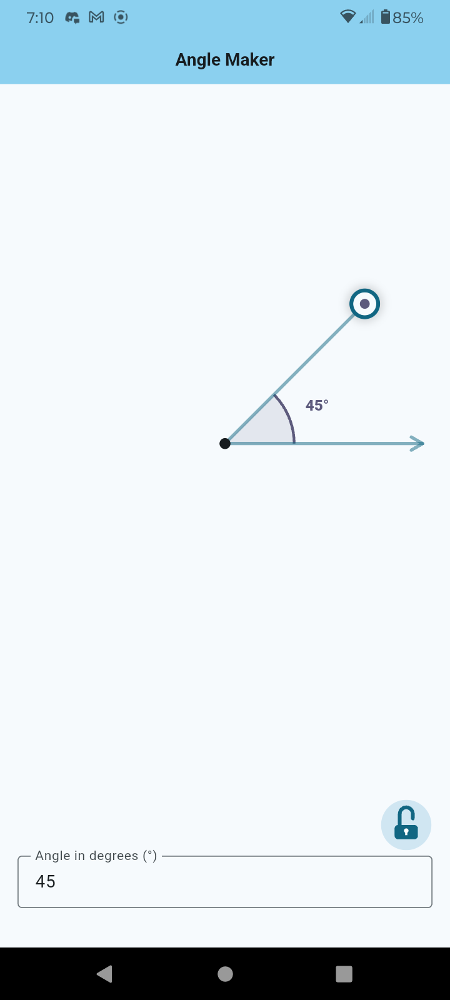
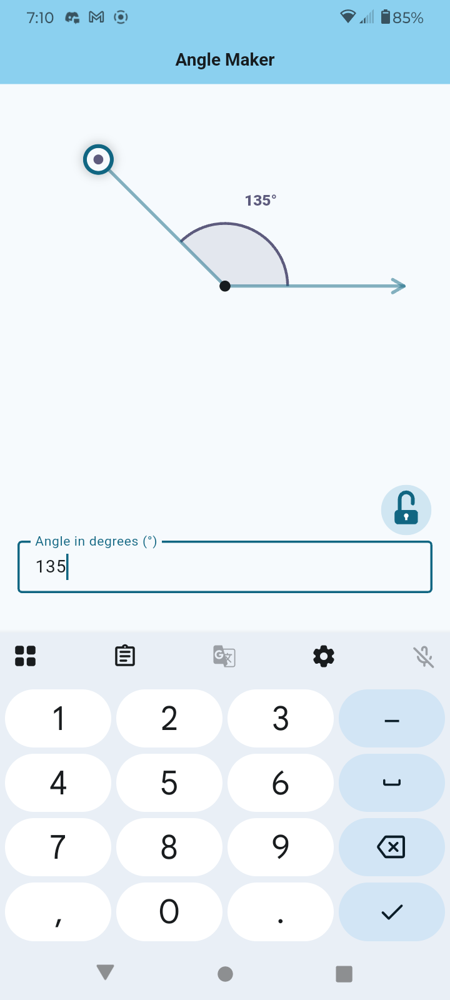

# Angle Maker

A mobile app built with Flutter and Dart.

Specify an angle and the app will draw it. Manually adjust the angle and the app will measure it. 

Tested on Android. I don't know how to make it work on iOS.

## Screenshots

## Using the App

- Tap and drag a circle on the end of a line to move that line and adjust the angle.
- Enter a value between 0 and 360 in the text field to set the angle.
- Tap the lock button to disable inputs until the lock button is tapped again.

## App Installation Overview

This is just how did it.

1. Get Android Studio and install Flutter.
2. I used AI to write the app, but you can use git to clone the project.
3. On your phone turn on Developer Options (Google it) and wireless debugging. I recommend USB debugging instead.
4. With the project open in Android Studio, on the right there's a Device Manager button. Click that and add your phone.
5. On the left side, there's a terminal button. Click that and run `flutter run --release` in the terminal.
6. Wait a long while. You may see some warnings in the terminal. If the app launches on your phone, the install was successful.

## License

This project is distributed under the terms described in the [`LICENSE`](LICENSE) file.

My intention is that others may use and modify it, as long as it's not redistributed with ads.